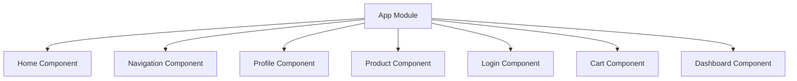
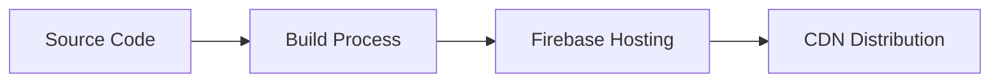

# LittleHopper Architecture Analysis

## Table of Contents
1. [System Overview](#system-overview)
2. [Architecture Components](#architecture-components)
3. [Design Patterns & Structure](#design-patterns--structure)
4. [Data Flow Analysis](#data-flow-analysis)
5. [Dependencies & Integration](#dependencies--integration)
6. [Deployment Architecture](#deployment-architecture)
7. [Recommendations](#recommendations)

## System Overview

LittleHopper is an Angular-based web application using version 15.1.0, implementing server-side rendering (SSR) through Angular Universal. The system follows a component-based architecture typical of Angular applications.

### Key Technologies
- Angular 15.1.0
- Firebase Hosting
- Express.js (for SSR)
- MDB Angular UI Kit
- Chart.js

## Architecture Components

### Core Components


### Component Structure
1. **App Component**: Root component
2. **Feature Components**:
   - Home
   - Navigation
   - Profile
   - Product
   - Login
   - Cart
   - Dashboard

## Design Patterns & Structure

### Architectural Patterns
1. **Component-Based Architecture**
   - Modular component structure
   - Clear separation of concerns

2. **Server-Side Rendering**
```typescript
@NgModule({
  imports: [
    AppModule,
    ServerModule,
  ],
  bootstrap: [AppComponent],
})
export class AppServerModule {}
```

3. **Lazy Loading Support**
   - Current implementation doesn't utilize lazy loading (recommendation for improvement)

## Data Flow Analysis

### Current Flow
1. Client Request → Angular Router
2. Component Initialization
3. Server-Side Rendering (if applicable)
4. Client-Side Hydration

### State Management
- No implemented state management solution (recommendation: implement NgRx/Redux)

## Dependencies & Integration

### External Dependencies
```json
{
  "@angular/animations": "^15.1.0",
  "@angular/cdk": "^15.0.0",
  "chart.js": "^3.1.1",
  "mdb-angular-ui-kit": "^4.0.0"
}
```

### Integration Points
1. Firebase Hosting
2. Express Server (SSR)
3. Chart.js Integration

## Deployment Architecture

### Firebase Deployment


### CI/CD Pipeline
- GitHub Actions integration for automated deployment
- Separate workflows for PR and merge events

## Recommendations

### 1. Architectural Improvements
- Implement lazy loading for feature modules
```typescript
// Recommended Route Configuration
{
  path: 'dashboard',
  loadChildren: () => import('./dashboard/dashboard.module')
    .then(m => m.DashboardModule)
}
```

### 2. State Management
- Implement NgRx for state management
```typescript
// Recommended Store Structure
├── store/
│   ├── actions/
│   ├── reducers/
│   ├── effects/
│   └── selectors/
```

### 3. Security Enhancements
- Implement route guards
- Add authentication service
```typescript
@Injectable({
  providedIn: 'root'
})
export class AuthGuard implements CanActivate {
  // Implementation
}
```

### 4. Performance Optimization
- Implement preloading strategies
- Add service workers for PWA support
- Optimize bundle size through code splitting

### 5. Testing Infrastructure
- Implement comprehensive unit testing
- Add e2e testing framework
- Implement test coverage requirements

### 6. Code Organization
- Implement feature modules
- Create shared module for common components
- Implement proper dependency injection hierarchy

## Scalability Considerations

1. **Horizontal Scaling**
   - Implement containerization
   - Consider microservices architecture for specific features

2. **Performance**
   - Implement caching strategies
   - Optimize asset loading
   - Consider implementing WebWorkers for heavy computations

3. **Maintainability**
   - Implement strict typing
   - Add comprehensive documentation
   - Follow Angular style guide strictly

This architecture analysis provides a foundation for future development and scaling of the LittleHopper application. Implementation of the recommended improvements should be prioritized based on business requirements and resource availability.