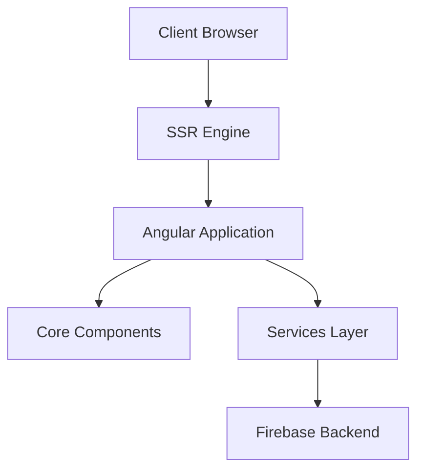

# LittleHopper - High Level Design Documentation

## Table of Contents
1. [System Overview](#system-overview)
2. [Architecture](#architecture)
3. [Component Design](#component-design)
4. [Integration Patterns](#integration-patterns)
5. [Technical Stack](#technical-stack)
6. [Infrastructure](#infrastructure)
7. [Recommendations](#recommendations)

## System Overview

LittleHopper is a web application built using Angular 15 with server-side rendering (SSR) capabilities. The system appears to be an e-commerce platform with user authentication, product management, and shopping cart functionalities.

### Key Features
- User authentication and profile management
- Product catalog and search
- Shopping cart functionality
- Responsive navigation system
- Server-side rendering for improved SEO

## Architecture

### High-Level Architecture Diagram


### Core Components
1. **Frontend Layer**
   - Angular 15 application
   - MDB Angular UI components
   - Client-side routing
   - Responsive design

2. **Server Layer**
   - Express.js server for SSR
   - Universal rendering engine
   - Static asset serving

3. **Infrastructure**
   - Firebase hosting
   - GitHub Actions for CI/CD

## Component Design

### Core Modules
```typescript
@NgModule({
  declarations: [
    AppComponent,
    HomeComponent,
    NavigationComponent,
    ProfileComponent,
    ProductComponent,
    LoginComponent
  ]
})
```

### Component Hierarchy
- App Root
  - Navigation
  - Home
  - Product
  - Profile
  - Login
  - Cart
  - Dashboard

### Key Components Details

1. **Navigation Component**
   - Responsive navbar implementation
   - Search functionality
   - Authentication status display
   - Mobile-friendly collapse menu

2. **Home Component**
   - Main entry point
   - Layout container
   - Component orchestration

3. **Product Component**
   - Product display
   - Catalog management
   - Search integration

## Integration Patterns

### Firebase Integration
```json
{
  "projects": {
    "default": "littlehopper-1606"
  }
}
```

### SSR Implementation
```typescript
server.engine('html', ngExpressEngine({
  bootstrap: AppServerModule,
}));
```

### CI/CD Pipeline
```yaml
name: Deploy to Firebase Hosting on merge
'on':
  push:
    branches:
      - master
```

## Technical Stack

### Frontend Technologies
- Angular 15.1.0
- MDB Angular UI Kit 4.0.0
- Chart.js 3.1.1
- SCSS for styling
- FontAwesome icons

### Backend Services
- Firebase hosting
- Express.js server
- Node.js runtime

### Development Tools
- Angular CLI
- TypeScript 4.9.4
- Karma for testing
- Firebase Tools

## Infrastructure

### Deployment Architecture
- Firebase Hosting
- GitHub Actions automation
- SSR-enabled deployment
- Production optimization

### Build Configuration
```json
{
  "build": {
    "builder": "@angular-devkit/build-angular:browser",
    "options": {
      "outputPath": "dist/littlehopper/browser",
      "optimization": true,
      "outputHashing": "all"
    }
  }
}
```

## Recommendations

1. **Architecture Improvements**
   - Implement state management (NgRx/Redux)
   - Add API service layer
   - Implement proper routing guards

2. **Security Enhancements**
   - Add authentication service
   - Implement route protection
   - Add input validation

3. **Performance Optimizations**
   - Implement lazy loading
   - Add service workers
   - Optimize bundle size

4. **Development Practices**
   - Add comprehensive testing
   - Implement proper error handling
   - Add logging service

5. **Infrastructure**
   - Set up staging environment
   - Implement monitoring
   - Add automated testing in CI/CD

### Priority Action Items
1. Set up proper routing and navigation
2. Implement authentication system
3. Add state management
4. Enhance error handling
5. Implement proper testing strategy

This documentation provides a high-level overview of the LittleHopper system. For detailed implementation specifics, please refer to individual component documentation and codebase comments.