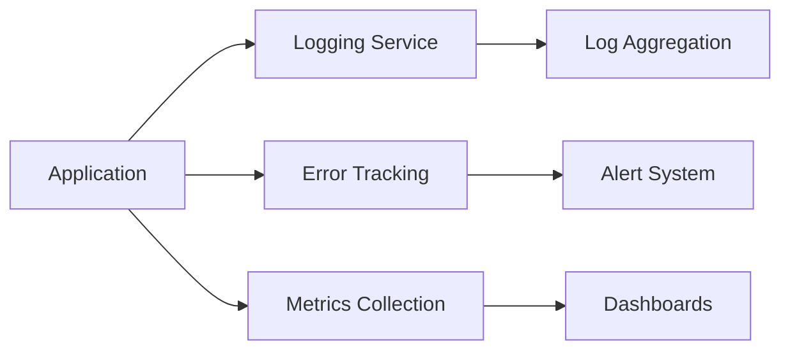

# LittleHopper Monitoring & Observability Analysis

## Table of Contents
- [Current State Analysis](#current-state-analysis)
- [Monitoring Gaps](#monitoring-gaps)
- [Recommendations](#recommendations)
- [Implementation Guide](#implementation-guide)
- [Technical Architecture Considerations](#technical-architecture-considerations)

## Current State Analysis

### Application Overview
LittleHopper is an Angular-based web application using Firebase hosting with the following characteristics:
- Angular v15.1.0 application with SSR support
- Firebase hosting deployment
- GitHub Actions for CI/CD
- Chart.js integration for data visualization

### Current Monitoring Setup
```markdown
✗ No dedicated monitoring solution
✗ No structured logging implementation
✗ No error tracking service
✗ Basic console logging only
✗ No performance monitoring
```

### Existing Infrastructure
- Firebase hosting environment
- Angular production builds with source maps
- Server-side rendering capabilities
- GitHub Actions workflow for deployment

## Monitoring Gaps

### 1. Application Logging
- No structured logging system
- Missing error boundary implementation
- No centralized log aggregation
- Limited debugging capabilities in production

### 2. Performance Monitoring
- No Real User Monitoring (RUM)
- Missing performance metrics collection
- No tracking of:
  - First Contentful Paint (FCP)
  - Time to Interactive (TTI)
  - Long tasks
  - Memory usage

### 3. Error Tracking
- No error reporting service
- Missing crash analytics
- No user session tracking
- No error correlation capabilities

### 4. Metrics Collection
- No application metrics gathering
- Missing business KPI tracking
- No custom metrics implementation
- Limited visibility into user behavior

## Recommendations

### 1. Implement Application Monitoring

```typescript
// Add Angular ErrorHandler
import { ErrorHandler, NgModule } from '@angular/core';
import { CustomErrorHandler } from './monitoring/error-handler';

@NgModule({
  providers: [
    { provide: ErrorHandler, useClass: CustomErrorHandler }
  ]
})
```

### 2. Add Logging Service

```typescript
// monitoring/logging.service.ts
export class LoggingService {
  logError(error: Error, context?: any) {
    // Implement structured logging
  }
  
  logMetric(name: string, value: number, tags?: Record<string, string>) {
    // Implement metric logging
  }
}
```

### 3. Integrate Monitoring Tools

Recommended stack:
- **Application Performance Monitoring**: New Relic or Datadog
- **Error Tracking**: Sentry
- **Logging**: ELK Stack or Stackdriver
- **Metrics**: Prometheus + Grafana

### 4. Add Performance Monitoring

```typescript
// monitoring/performance.service.ts
import { PerformanceObserver } from 'perf_hooks';

export class PerformanceService {
  trackMetric(name: string) {
    const observer = new PerformanceObserver((list) => {
      // Report metrics
    });
    observer.observe({ entryTypes: ['measure'] });
  }
}
```

## Implementation Guide

### Phase 1: Foundation
1. Set up error tracking with Sentry
2. Implement basic logging service
3. Add performance monitoring
4. Configure basic metrics collection

### Phase 2: Enhanced Monitoring
1. Set up log aggregation
2. Configure custom dashboards
3. Implement alerts and notifications
4. Add user session tracking

### Phase 3: Advanced Features
1. Implement distributed tracing
2. Add business metrics tracking
3. Set up automated anomaly detection
4. Configure advanced alerting rules

## Technical Architecture Considerations

### 1. Monitoring Integration Points
```typescript
@NgModule({
  imports: [
    // Add monitoring modules
    MonitoringModule.forRoot({
      errorTracking: true,
      performance: true,
      logging: true
    })
  ]
})
```

### 2. Data Flow


### 3. Configuration Management
```json
{
  "monitoring": {
    "errorTracking": {
      "dsn": "YOUR_SENTRY_DSN",
      "environment": "production",
      "sampleRate": 1.0
    },
    "logging": {
      "level": "info",
      "destination": "elk"
    },
    "metrics": {
      "interval": 60,
      "prefix": "littlehopper"
    }
  }
}
```

## Security Considerations
- Implement secure token handling for monitoring services
- Configure appropriate access controls
- Ensure PII data is not logged
- Set up audit logging for sensitive operations

## Best Practices
1. Use structured logging formats
2. Implement proper error boundaries
3. Set up meaningful alerts
4. Configure appropriate sampling rates
5. Maintain monitoring documentation

The implementation of these recommendations will provide comprehensive visibility into the application's health, performance, and user experience.